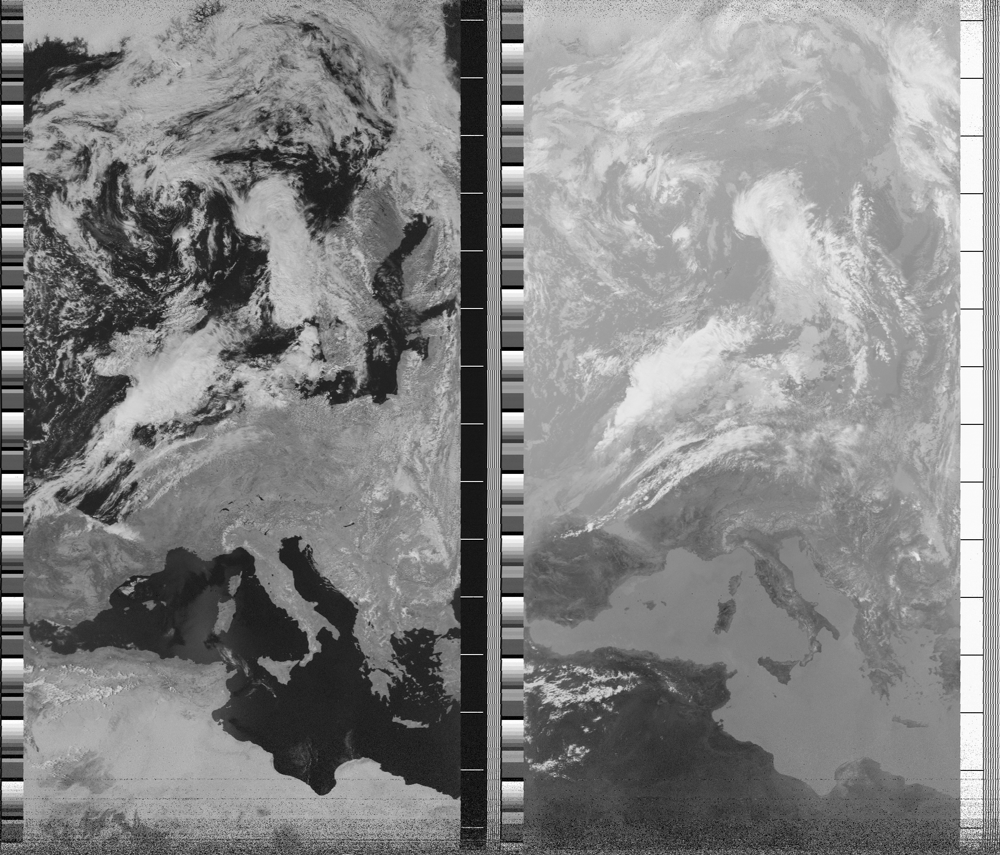
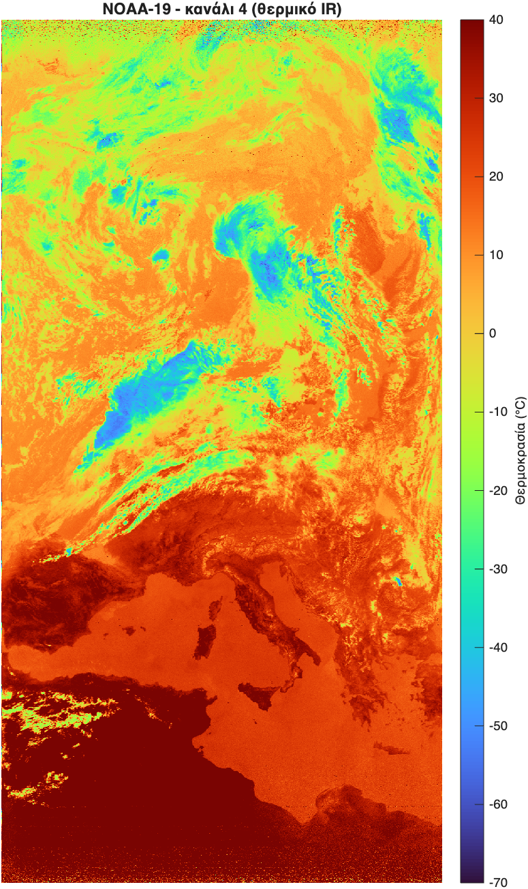
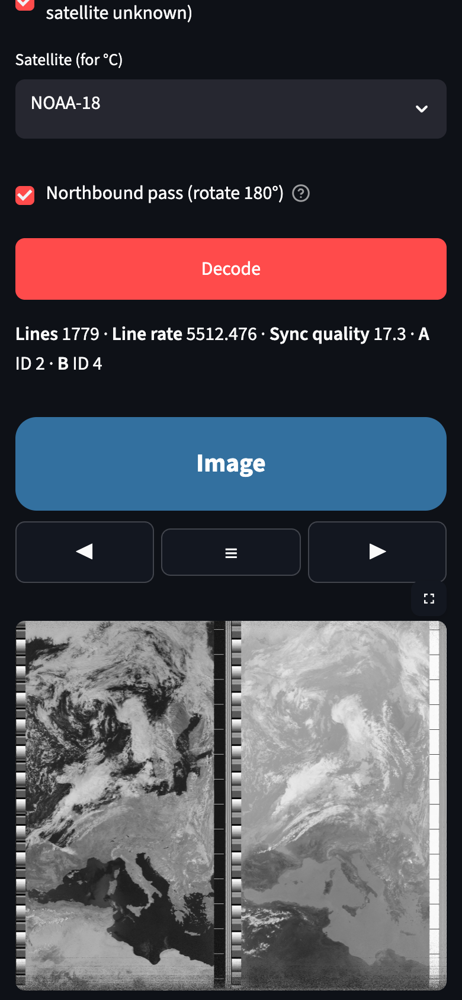
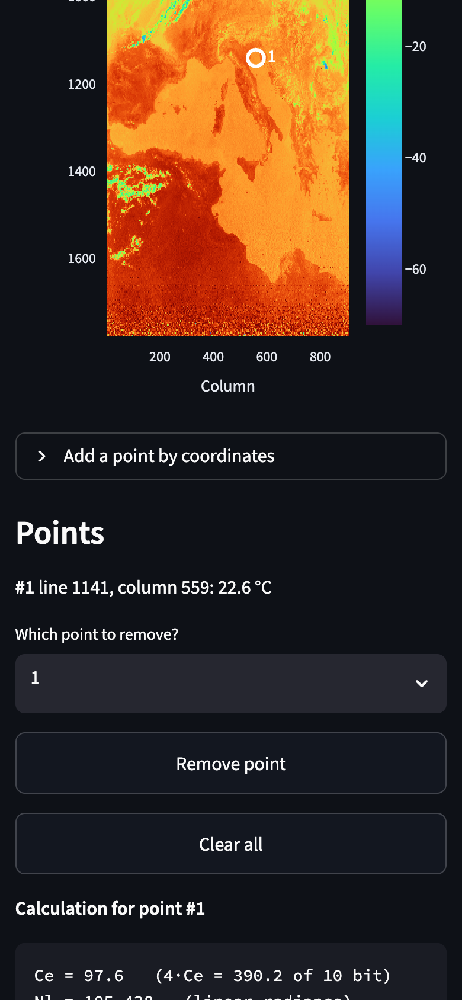
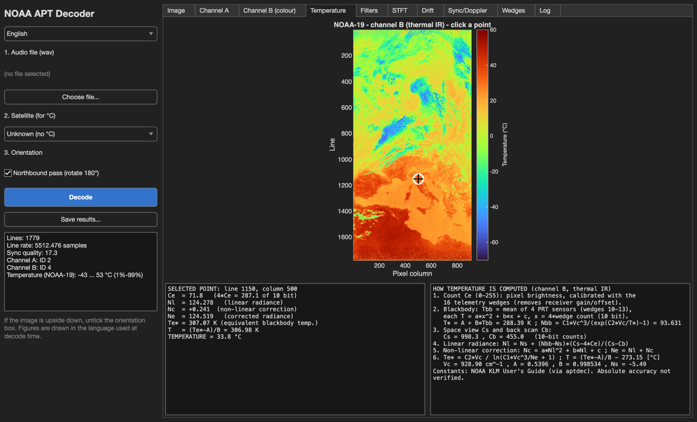

# NOAA APT DSP decoder

**Live web app (works on a phone): https://noaaaptdsp.streamlit.app**

Decode **NOAA APT** weather-satellite recordings (audio `.wav`) into images and temperature maps
using digital signal processing. Two implementations that give the same results:

| | Folder | Run |
|---|---|---|
| MATLAB (script + GUI app) | [`matlab/`](matlab) | `satilite_app` or `satilite('file.wav')` |
| Python web app (works on a phone) | [`web/`](web) | `streamlit run web/app.py` |



## What it does
1. **Demodulation:** FIR band-pass (64 taps, Hamming) -> Hilbert analytic-signal envelope -> zero-phase Butterworth low-pass.
2. **Clock drift:** line-rate search (max column variance), refined with the Sync-A pulse train.
3. **Synchronisation:** Sync-A correlation, per-line Doppler correction, optional 180 deg rotation.
4. **Calibration:** 16-wedge telemetry (levels 31.07 ... 255) -> look-up table; channel ID is read from wedge 16.
5. **Temperature (deg C):** PRT blackbody + Planck radiance + non-linear correction (NOAA KLM method).
   Click or hover on the map to read the temperature and see the calculation step by step.



## Screenshots
<p>


</p>

MATLAB app (temperature map, hover/click points, step-by-step calculation):



## macOS app (Apple Silicon only: M1 / M2 / M3 / M4)
A compiled copy of the MATLAB app for Macs with an Apple Silicon chip:
[`downloads/NOAA_APT_Decoder_macOS_AppleSilicon.zip`](downloads/NOAA_APT_Decoder_macOS_AppleSilicon.zip)
- It needs the free **MATLAB Runtime R2026b** (Apple Silicon): https://www.mathworks.com/products/compiler/mcr/index.html
  (large download; no MATLAB licence needed).
- The app is **not signed by Apple**: remove the quarantine flag or right-click -> Open the first time.
  The exact steps are in `READ_ME_FIRST.txt` inside the zip.
- Not for Intel Macs, Windows or Linux. Tested only on the Mac that built it (with a full MATLAB install used
  as the runtime), **not** yet on a machine with only the Runtime installed.

## Python web app
```
cd web
python3 -m venv .venv
.venv/bin/pip install -r requirements.txt
.venv/bin/streamlit run app.py
```
Open http://localhost:8501. Deploy for free on Streamlit Community Cloud (main file: `web/app.py`).
Greek and English interface. A sample recording is included (`web/sample/noaa3.wav`).

## MATLAB
Needs the Signal Processing Toolbox. `cd matlab`, then `satilite_app` (GUI) or
`r = satilite('recording.wav', true, 'out_folder', 'NOAA-19');`.

## Validation
On the sample file the Python version reproduces the MATLAB results (1779 lines, line rate 5512.476
samples, Sync quality 17.3, channels A = ID 2, B = ID 4, temperature range -42.9 ... 52.8 deg C);
images differ by at most 1/255 on individual pixels.

## Limits (please read)
- The sample recording's satellite and date are **unknown**. Temperatures use the constants of the
  selected satellite; for the sample, NOAA-15/18/19 give almost identical results, but **absolute
  accuracy has not been verified** against an independent measurement.
- Expects 11025 Hz mono audio (other rates are not resampled yet).
- Orientation (northbound/southbound pass) is a user option, not detected automatically.

## Credits and licence
- Temperature/calibration constants and method: NOAA KLM User's Guide, via
  [aptdec](https://github.com/Xerbo/aptdec) by Xerbo (GPL-2.0). This project is therefore released under **GPL-2.0** (see `LICENSE`).
- Sample recording `noaa3.wav`: from [0jk6/noaa-apt-decoder](https://github.com/0jk6/noaa-apt-decoder) (MIT, (c) 2021 Jayachandra Kasarla).
